# Архитектура Android-слоя Antigravity (`app/`)

Модуль `app/` представляет собой нативный Android-хост (Native Host Shell) для среды **Antigravity v2.4+ (Android ARM64, Bionic + Glibc userspace, targetSdk 28 / minSdk 24)**. 

Хост отвечает за запуск и супервизию Go-ядра `language_server`, предоставление защищенного UI-контейнера на базе Chromium WebView, локальный HTTP-шлюз системных функций (System Gateway Server) и интеграцию с платформой Android (уведомления, энергосбережение, буфер обмена, хранилище, Shizuku/rish).

---

## 1. Общая архитектура компонентов

```mermaid
graph TD
    subgraph UI_Layer ["Слой представления (UI Layer)"]
        LDA["LauncherDarkActivity / LauncherLightActivity"] --> MA["MainActivity"]
        MA --> SC["SplashController (NativeSplashDotsView / Lazy WebView)"]
        MA --> WVH["WebViewHost (Chromium WebView)"]
        WVH --> AWVC["AgyWebViewClient (OAuth & Asset Interceptor)"]
        WVH --> AWCC["AgyWebChromeClient (Console, Files, Popups)"]
        WVH --> LAS["LocalAssetServer (Внутрипроцессная раздача files/web/)"]
        WVH --> AHI["AppHtmlInjector (Инжекция __APP_CONFIG__ и токенов)"]
    end

    subgraph Bridge_Layer ["Bridge & Security"]
        MA --> AB["AndroidBridge (JavascriptInterface 'Android')"]
        AB --> UB["UiBridge (onUiReady, fatal errors, desktop mode)"]
        AB --> TB["ThemeBridge (Синхронизация тем)"]
        AB --> EB["EngineBridge (Статус и параметры ядра)"]
        AB --> ECJ["EngineConfigJson (Сериализация конфигурации)"]
    end

    subgraph Core_Layer ["Фоновые сервисы и супервизия (Core Layer)"]
        CSS["CoreServerService (Foreground Service + WakeLock)"]
        CSS --> CPS["CoreProcessSupervisor (Управление жизненным циклом ядра)"]
        CPS --> CL["CoreLauncher (Установка фазы 1 и запуск процесса)"]
        CPS --> CRP["CoreReadyProbe (Зондирование https://127.0.0.1:port)"]
        CPS --> OUW["OpenUrlWatcher (Перехват OAuth/URL из stdout потока)"]
        CPS --> LS["Процесс language_server (Glibc / ARM64)"]
        CSS --> AGD["Фоновый демон agy-daemon (CLI Task Engine)"]
    end

    subgraph Gateway_Layer ["Системный шлюз (System Gateway)"]
        CSS --> SGS["SystemGatewayServer (HTTP Server на 127.0.0.1:45161)"]
        SGS --> GD["GatewayDispatcher"]
        GD --> NH["NotificationHandler (Каналы задач и алертов)"]
        GD --> BH["BrowserHandler (Открытие системного браузера)"]
        GD --> PH["PowerHandler (Управление частичными WakeLock)"]
        GD --> CH["ClipboardHandler (Чтение/запись системного буфера)"]
        GD --> DH["DeviceHandler (Батарея, сеть, вибро, тосты)"]
        GD --> EH["ExecHandler (Локальное выполнение команд и rish)"]
    end

    subgraph Platform_Layer ["Интеграция с Android"]
        AFP["AppFileProvider (${applicationId}.fileprovider)"]
        DCH["DocumentsContractHelper (Преобразование SAF в /storage/...)"]
        SHB["ShizukuBridge / RishExecutor (ADB Shell uid=2000)"]
        LIS["LauncherIconSwitcher (Динамическая смена иконки)"]
    end

    WVH -.->|JS Call| AB
    LS -.->|Stdout Stream| OUW
    AGD -.->|JSON over HTTP| SGS
    NH -.->|Android Notifications| Platform_Layer
    EH -.->|Elevated Shell| SHB
```

---

## 2. Ключевые подсистемы

### 2.1. Фоновые сервисы и управление ядром (`com.agy.core`)

Ядро системы (`language_server`) компилируется под Linux/Glibc и выполняется в окружении Android через кастомный загрузчик `libloader.so` с эмуляцией инструкций LSE (`liblse_compat.so`).

- **`CoreServerService`**: 
  - Запускается как `ForegroundService` с типом `dataSync` и иконкой в трее (`ForegroundNotification`).
  - Удерживает CPU WakeLock (`WakeLockHolder`) с флагом `PARTIAL_WAKE_LOCK`, гарантируя непрерывную работу агента при выключенном экране.
  - Управляет жизненным циклом супервизора ядра, HTTP Gateway и фонового демона `agy-daemon`.
- **`CoreLauncher`**:
  - Управляет установкой фазы 1 (распаковка и верификация ядра) и запуском нативного процесса.
  - Содержит `killOrphanCoreProcesses()`: сканирует `/proc` и принудительно завершает (`SIGKILL`) любые зависшие orphan-процессы `language_server` от предыдущих сессий перед стартом, исключая ошибку `EADDRINUSE` (`listen: address already in use`) на фиксированных loopback-портах 45157/45158.
- **`CoreProcessSupervisor`**:
  - Запускает ядро в выделенном рабочем потоке (`CoreServerThread`).
  - Непрерывно стримит объединенный поток stdout/stderr в `files/logs/core.log` и кольцевой буфер `LogRingBuffer`.
  - Реализует политику самовосстановления (`CoreRestartPolicy`): экспоненциальный backoff при неожиданном падении (до 3 перезапусков). Если ядро проработало стабильно более 60 секунд (`SUSTAINED_READY_MS`), счетчик падений обнуляется.
  - При фатальных ошибках фиксирует детальный стек в `CrashRecorder`.
- **`CoreReadyProbe`**:
  - Выполняет опрос готовности локального HTTPS порта с таймаутом до 60 секунд (`READY_TIMEOUT_MS = 60000`) для стабильного первого холодного запуска на процессорах ARMv8.0-A (Snapdragon 660 и др.).
  - Выполняет криптографический Certificate Pinning по SHA-256 дайджесту сертификата `@raw/agy_core_cert`.
- **`OpenUrlWatcher`**:
  - Решает проблему перехвата OAuth-авторизации Google (Google блокирует авторизацию внутри встроенного WebView).
  - Считывает строки вывода `language_server` в реальном времени, выявляя маркеры `AGY_OPEN_URL=`, `ANTIGRAVITY_OPEN_URL:` и ссылки `accounts.google.com`.
  - Перенаправляет пользователя в дефолтный внешний браузер через `CustomTabLauncher`.
  - Также слушает защищенный broadcast `com.agy.ACTION_OPEN_URL`.

### 2.2. WebView, UI и загрузка приложения (`com.agy.ui`)

- **Двухфазная схема запуска (Splash & Ready Flow)**:
  1. `MainActivity` стартует с нативным Canvas-экраном (`NativeSplashDotsView`), не инициализируя тяжелый Chromium WebView для анимации трех точек (экономия ~40 МБ RAM).
  2. Параллельно `CoreServerService` распаковывает ядро и ожидает готовности локального HTTPS порта (зонд `CoreReadyProbe`).
  3. После ответа порта `WebViewHost.loadApp()` инжектирует HTML и конфигурацию.
  4. Скрытие сплэша происходит только по сигналу первого рендера из JavaScript (`window.Android.onUiReady()`), исключая мерцание белого экрана.
- **`LocalAssetServer`**:
  - Перехватывает вызовы `shouldInterceptRequest` в `AgyWebViewClient` для Same-Origin адреса `https://127.0.0.1:<port>/*`.
  - Статические файлы (`files/web/*`) отдаются напрямую из локального кэша приложения в памяти, не нагружая Go-сервер ядра. RPC и веб-сокеты (`/exa.*`, `/jetski.*`, streaming) прозрачно пропускаются к ядру.
- **`AppHtmlInjector`**:
  - Внедряет в `<head>` веб-бандла строгую директиву Content-Security-Policy (CSP).
  - Инициализирует глобальные объекты `window.__APP_CONFIG__`, `window.__AG_ENDPOINTS__`, `window.__AG_CSRF__` и одноразовый криптографический токен `blobBridgeToken`.
- **Файловый пикер и загрузки (`FileDownloader`)**:
  - Обрабатывает загрузки обычных файлов и Base64 Blobs (`saveBlob`).
  - Поддерживает выбор файлов и папок через Storage Access Framework (SAF) и сохранение персистентных разрешений (`takePersistableUriPermission`).

### 2.3. Системный шлюз (`com.agy.gateway`)

Встроенный высокопроизводительный HTTP-сервер (`SystemGatewayServer`), слушающий строго на `127.0.0.1:45161` (с авто-фоллбэком на порт `+2` при занятости). Номер порта сохраняется в `files/logs/gateway.port`.

Шлюз обеспечивает мост между окружением Linux (bash-скрипты, CLI-утилиты `agy-notify`, `agy-daemon`) и нативными Android API:

| Команда | Обработчик | Описание |
| :--- | :--- | :--- |
| `notify` | `NotificationHandler` | Публикация, обновление прогресса и отмена Android-уведомлений в каналах `agy_tasks` и `agy_alerts`. |
| `open_url` | `BrowserHandler` | Открытие внешних ссылок и системных документов через `UriDispatcher`. |
| `wakelock` | `PowerHandler` | Захват и освобождение именованных частичных WakeLock'ов для длительных скриптов. |
| `clipboard` / `clipboard_set` | `ClipboardHandler` | Асинхронное чтение и запись в системный буфер обмена на UI-потоке. |
| `system_info` | `DeviceHandler` | Сбор телеметрии: уровень заряда батареи, статус зарядки, тип сети, свободная память и диск. |
| `vibrate` | `DeviceHandler` | Тактильный отклик (Haptic Feedback) заданной длительности. |
| `toast` | `DeviceHandler` | Отображение нативных всплывающих сообщений (Toast). |
| `exec` | `ExecHandler` | Выполнение команд в шелле (`/system/bin/sh` или повышенный `rish` через Shizuku) с таймаутом и захватом потоков. |
| `/gateway/status` | `SystemGatewayServer` | Проверка состояния шлюза (health check). |
| `/gateway/logs` | `SystemGatewayServer` | Чтение последних строк системного лога из кольцевого буфера памяти. |
| `/gateway/commands` | `SystemGatewayServer` | История выполненных шлюзом команд и их статусов. |
| `/gateway/crash` | `SystemGatewayServer` | Диагностический снимок последнего падения ядра. |

### 2.4. Безопасность и JavaScript Bridge (`com.agy.bridge`)

Класс `AndroidBridge` предоставляет минимальный, жестко изолированный интерфейс для фронтенда (`@JavascriptInterface`).

- **Защита от сторонних фреймов:** Опасные операции (`onUiReady`, `onUiError`, `saveBlob`) требуют передачи криптографического токена `blobBridgeToken`, известного только доверенному верхнеуровневому документу. Сравнение токенов производится через `MessageDigest.isEqual` во избежание timing-атак.
- **Изоляция:** Из интерфейса `AndroidBridge` исключен доступ к выполнению шелла, отправке произвольных нотификаций и прямому доступу к Shizuku. Все привилегированные операции вынесены в локальный шлюз `SystemGatewayServer`.

### 2.5. Динамические иконки и темы (`com.agy.theme`)

- **Архитектурный паттерн Duolingo-style Launcher:**
  Вместо `activity-alias` в манифесте объявлены два реальных Activity:
  - `LauncherDarkActivity extends MainActivity` (тема `@style/SplashThemeDark`)
  - `LauncherLightActivity extends MainActivity` (тема `@style/SplashThemeLight`)
  Это необходимо для того, чтобы системный Window Splash на Android 12+ (API 31) отображал правильный цвет фона и логотип в соответствии с выбранной темой приложения, а не системной темой дня/ночи.
- **`LauncherIconSwitcher`**:
  Переключает включенное состояние (`setComponentEnabledSetting`) между активностями с флагом `DONT_KILL_APP` строго в момент ухода приложения в фон (`onStop`), предотвращая сброс сессии пользователя.

---

## 3. Результаты аудита и рекомендации

### 3.1. Утечки памяти (Memory Leaks)
1. **Утечка `MainActivity` через `UiBridge` (ИСПРАВЛЕНО):** В `MainActivity.onDestroy()` добавлен вызов `androidBridge.setActivity(null)`. В `UiBridge` и `AndroidBridge` ссылки на `MainActivity` заменены на `WeakReference<MainActivity>`, что предотвращает утечку активити при смене ориентации и пересоздании.
2. **Утечка WebView в `PopupWindowHandler` (ИСПРАВЛЕНО):** При срабатывании `window.open` после передачи URL во внешний браузер через `oauth.openInBrowser()` вызывается `popup.destroy()`, освобождая нативные ресурсы WebView всплывающего окна.
3. **Статическая ссылка на Base64 в `FileDownloader`:** Поле `private static DownloadTask pendingTask` удерживает до 64 МБ Base64 данных при ожидании диалога разрешений. Если пользователь нажимает "Отмена", память не освобождается.
   - *Рекомендация:* Сохранять временный файл на диск вместо удержания строки в памяти, либо сбрасывать задачу по таймауту.
4. **Накопление объектов `WakeLock` в `PowerHandler` (ИСПРАВЛЕНО):** Реализована автоматическая очистка неактивных или отпущенных блокировок (`!lock.isHeld()`) через метод `cleanupUnheld()`, а также удаление блокировок из `ConcurrentHashMap` при проверке `status` и после `acquire`, что устраняет утечку памяти при истечении таймаута (`timeout_ms`).
5. **Защита от OOM в `SystemGatewayServer` (ИСПРАВЛЕНО):** В методе `readHeaderLine` добавлен лимит максимальной длины строки заголовка (8192 байта), предотвращающий DoS/OOM при отправке бесконечных заголовков.

### 3.2. Мертвый код (Dead Code)
Следующие классы удалены из проекта (не использовались ни одним компонентом):
- `com.agy.bridge.ShellBridge` (удален)
- `com.agy.bridge.ExternalUrlBridge` (удален)
- `com.agy.bridge.NotificationBridge` (удален)
- `com.agy.install.ChmodRunner` (удален)
- `com.agy.oauth.AuthReloader` (удален)
- `com.agy.oauth.AuthTokenPoller` (удален)
- `com.agy.ui.lifecycle.DeepLinkForwarder` (удален)
- `com.agy.ui.splash.SplashLoadingHtml` (удален)
- `com.agy.util.LoopbackHost` (удален)
- `com.agy.util.PackageInspector` (удален)

### 3.3. Костыли с путями и IPC
- **Интеграция `ExecHandler` с `rish` (ИСПРАВЛЕНО):** В `ExecHandler` реализован автоматический поиск пути к бинарнику `rish` (проверка `$PREFIX/bin/rish`, `files/runtime/bin/rish`), обязательная передача `RISH_APPLICATION_ID` (`context.getPackageName()`) для авторизации Shizuku и сброс потенциально конфликтующего `LD_LIBRARY_PATH`.
- **Хардкод `/storage/emulated/0/` (ИСПРАВЛЕНО):** В `DocumentsContractHelper` и `LogExporter` жестко прописанный путь первичного пользователя заменен на `Environment.getExternalStorageDirectory().getAbsolutePath()`, гарантируя корректную работу в рабочих профилях (Work Profile) и для мультипользовательских окружений (`/storage/emulated/<userId>/`).
- **Уязвимость `AppFileProvider` (ИСПРАВЛЕНО):** В `getFileForUri` добавлена проверка канонического пути (`file.getCanonicalPath()`) против разрешенных каталогов песочницы (`filesDir`, `cacheDir`, `dataDir`, `getExternalStorageDirectory()`, `getExternalFilesDir()`), защищающая от атак типа Path Traversal (`../`).
