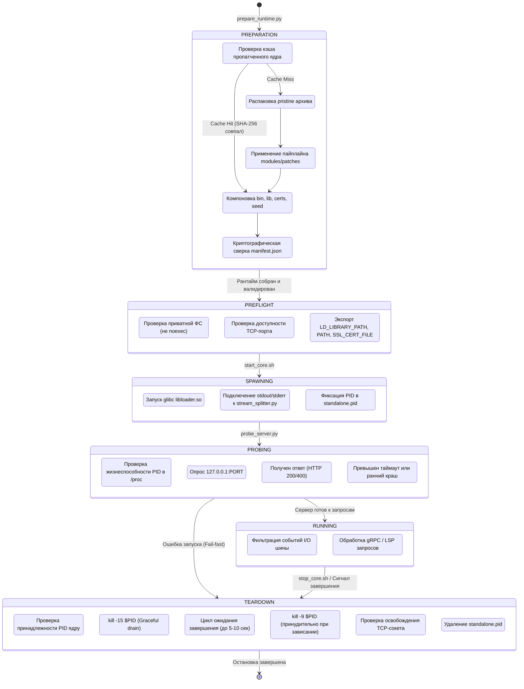

# Модуль запуска и управления рантаймом (`modules/runner`)

> **Архитектурный аудит и руководство по жизненному циклу рантайма Antigravity Standalone Core на платформе Android**

---

## 1. Архитектура и назначение файлов

Модуль `modules/runner` является оркестратором сборки, подготовки, запуска, контроля работоспособности и корректной остановки standalone-рантайма Antigravity v2 на устройствах Android (архитектура ARM64 / `aarch64`).

```
modules/runner/
├── prepare_runtime.py   # Сборщик и валидатор целостности рантайма
├── start_core.sh        # Скрипт фонового запуска ядра с интеграцией I/O шины
├── probe_server.py      # Монитор готовности сервера (liveness/readiness probe)
├── stop_core.sh         # Скрипт graceful-остановки и очистки ресурсов
├── test_e2e.sh          # Сквозной интеграционный E2E-тест всего цикла
└── README.md            # Спецификация жизненного цикла и результаты аудита
```

### Состав компонентов

| Файл | Язык | Назначение | Ключевые зависимости |
|---|---|---|---|
| `prepare_runtime.py` | Python 3 | Распаковка pristine ядра, применение патчей, компоновка `standalone_runtime/`, сверка `manifest.json` | `modules/core`, `modules/patches` |
| `start_core.sh` | Bash | Настройка glibc-загрузчика, Bionic-библиотек, запуск ядра и конвейера `stream_splitter.py` в фоне | `modules/io`, `libloader.so`, `liblse_compat.so` |
| `probe_server.py` | Python 3 | Опрос локального TCP/HTTP порта до подтверждения готовности или таймаута | `urllib.request`, `socket` |
| `stop_core.sh` | Bash | Остановка серверного процесса: чтение PID, отправка `SIGTERM`, ожидание, эскалация до `SIGKILL` | Linux `/proc`, `kill` |
| `test_e2e.sh` | Bash | Автоматический прогон полного цикла: сборка -> запуск -> probe -> проверка логов -> остановка | Все утилиты runner |

---

## 2. Жизненный цикл рантайма (Runtime Lifecycle)

Жизненный цикл процесса Antigravity Core состоит из 6 последовательных фаз:



### Детальное описание фаз:

1. **Фаза сборки (Preparation):**
   - Выполняется скриптом `prepare_runtime.py`.
   - Проверяется кэш пропатченного бинарника (`language_server_patched_aa7d4a1e`). Если кэш отсутствует, из `modules/core/pristine/language_server.tar.gz` извлекается оригинальное ядро и пропускается через `modules/patches/pipeline.py`.
   - В целевой каталог (`standalone_runtime`) компонуются каталоги: `bin/` (с `liblanguage_server.so`, `libloader.so` и browser-шимами), `lib/` (glibc-библиотеки), `certs/` (`ca-certificates.crt`), `seed/` (шаблоны конфигураций).
   - Проверяется криптографический манифест `manifest.json` по алгоритму SHA-256.

2. **Фаза предстартовой подготовки (Pre-flight):**
   - Проверяется файловая система: каталог запуска должен быть доступен для выполнения (`noexec` недопустим).
   - Проверяется отсутствие конфликтов портов: целевой порт (по умолчанию `45159`) должен быть свободен.

3. **Фаза запуска и изоляции (Spawning):**
   - Выполняется скриптом `start_core.sh`.
   - Поскольку Android использует Bionic libc (`/system/bin/linker64`), а бинарник ядра скомпилирован под стандартный glibc Linux (`aarch64-linux-gnu`), ядро запускается через динамический загрузчик `libloader.so` (`ld-linux-aarch64.so.1`):
     ```bash
     "$LOADER" --library-path "$RT/lib" [--preload "$LSE_COMPAT"] "$CORE" [аргументы...]
     ```
   - Потоки `stdout` и `stderr` направляются через конвейер в перехватчик `stream_splitter.py`, который фильтрует логи и транслирует события в шину `EventBroker`.
   - В файл `standalone.pid` записывается PID процесса.

4. **Фаза проверки готовности (Probing):**
   - Скрипт `probe_server.py` периодически опрашивает сокет сервера на порту `45159`.
   - Ядро слушает TLS на порту `--https_server_port 45159`. При подключении по HTTP сервер возвращает `400 Bad Request`, что сигнализирует о том, что сокет активен и стек готов принимать запросы.

5. **Фаза активной работы (Running):**
   - Сервер обслуживает запросы Language Server Protocol и gRPC.
   - События (открытие URL, изменение задач, алерты об ошибках) обрабатываются шиной I/O.

6. **Фаза остановки (Teardown):**
   - Выполняется скриптом `stop_core.sh`.
   - Извлекается PID из `standalone.pid`.
   - Процессу отправляется сигнал `SIGTERM` (`kill -15`) для штатного завершения фоновых потоков, коммита транзакций SQLite и сброса буферов.
   - Скрипт ожидает завершения процесса. Если процесс не завершился в течение таймаута, отправляется `SIGKILL` (`kill -9`).
   - Удаляется PID-файл.

---

## 3. Специфика и ограничения Android

1. **Монтирование `noexec` на общем хранилище:**
   - Внешняя память (`/storage/emulated/0`, `/sdcard`) смонтирована с флагом `noexec`. Попытка запустить бинарник или загрузчик из `/storage/emulated/0` возвращает ошибку ядра `EACCES (Permission denied)`.
   - **Требование:** Рантайм обязан размещаться строго во внутреннем каталоге приложения (`/data/user/0/$APP_ID/files/...`).
2. **Сосуществование Glibc и Bionic:**
   - Системный интерпретатор Python 3 и bash используют библиотеки Bionic (`$PREFIX/lib`).
   - Ядро использует библиотеки glibc из `$RT/lib`.
   - `start_core.sh` изолирует переменные окружения, передавая пути библиотек glibc через аргумент `--library-path` загрузчика, предотвращая поломку хостовых бинарников.
3. **Эмуляция атомиков ARMv8.1-A LSE:**
   - На ядрах без аппаратной поддержки LSE используется перехватчик `liblse_compat.so`, устанавливающий ядровый обработчик сигнала `SIGILL` (4).
4. **Управление жизненным циклом и LowMemoryKiller (LMK):**
   - Процессы в Android могут быть принудительно вытеснены ядром при нехватке памяти. Запуск в составе Foreground Service с Partial WakeLock минимизирует этот риск.

---

## 4. Результаты аудита и статус устранения дефектов (Заход 2)

В ходе системного аудита и рефакторинга подсистемы `modules/runner` все выявленные дефекты были полностью устранены:

### Проблема 1: Подмена PID в конвейере subshell (Устранено)
- **Файл:** `start_core.sh`
- **Было:** `( CMD | python3 ... ) &; SERVER_PID=$!` сохранял PID оболочки subshell вместо бинарника ядра.
- **Реализовано:** Запуск через именованный канал FIFO (`core_stream.fifo`) и активация управления заданиями `set -m`.
  1. Фоновый перехватчик `stream_splitter.py` читает из FIFO и пишет в `core_output.log` (`SPLITTER_PID`).
  2. Ядро запускается напрямую с выводом в FIFO (`CORE_PID`), без промежуточных subshell.
  3. Фиксируются реальный PID ядра, PID перехватчика и PGID группы процессов в файлах `standalone.pid`, `standalone.splitter_pid`, `standalone.pgid` и JSON-метаданных `standalone.json`.

### Проблема 2: Жесткий `sleep 1` перед `kill -9` (Устранено)
- **Файл:** `stop_core.sh`
- **Было:** Фиксированная пауза `sleep 1` с последующим жестким `kill -9`.
- **Реализовано:** Заменено на циклический опрос `kill -0 "$PID"` каждые 0.1 с с таймаутом до 5.0 с (до 50 итераций).
  - Если ядро завершилось штатно за доли секунды, остановка происходит мгновенно без лишнего ожидания.
  - Только при зависании процесса свыше 5 секунд отправляется эскалационный сигнал `SIGKILL` (`kill -9`).

### Проблема 3: Опасность повторного использования PID (PID Recycling Hazard) (Устранено)
- **Файл:** `stop_core.sh`
- **Было:** Слепой вызов `kill -0 "$PID"` без валидации владельца.
- **Реализовано:** Перед отправкой любых сигналов проверяется содержимое `/proc/$PID/cmdline`. Сигналы отправляются исключительно в том случае, если сигнатура процесса действительно содержит `language_server`. При несовпадении выводится предупреждение, а чужой процесс не затрагивается.

### Проблема 4: Отсутствие pre-flight проверки занятости порта (Устранено)
- **Файл:** `start_core.sh`
- **Было:** Попытка привязки к уже занятому порту приводила к скрытой ошибке и маскировке состояния.
- **Реализовано:** 
  1. Встроена проверка доступности порта через сокетное соединение `/dev/tcp/127.0.0.1/$PORT`.
  2. Добавлена строгая защита служебных портов: порты 45157 и 45158 зарезервированы за основным рантаймом Antigravity IDE, запуск standalone-ядра на них блокируется с ошибкой.
  3. При обнаружении занятости порта 45159 скрипт сначала пытается корректно остановить предыдущий экземпляр через `stop_core.sh`, а затем сканирует `/proc` на наличие процессов-зомби standalone ядра (`antigravity-app-standalone` + `language_server` + `$PORT`) и завершает их.
  4. Если порт не освобождается в течение 2 секунд, запуск прерывается с информативной ошибкой.

### Проблема 5: Валидация кэша в `prepare_runtime.py` (Устранено)
- **Файл:** `prepare_runtime.py`
- **Было:** `TARGET_SHA` не проверялся, любой поврежденный файл с подходящим именем слепо копировался.
- **Реализовано:** Добавлена поблочная проверка SHA-256 кэшированного бинарника ядра (`ec217e58...`). При несовпадении хэша кэш признается невалидным, и ядро заново распаковывается и патчится.

### Проблема 6: Зависание `probe_server.py` при раннем краше сервера (Устранено)
- **Файл:** `probe_server.py`
- **Было:** 40-секундное блокирующее ожидание HTTP ответа, даже если процесс ядра упал на первой секунде.
- **Реализовано:** Реализован fail-fast механизм: в каждой итерации опроса проверяется жизнеспособность процесса через `os.kill(target_pid, 0)`. При раннем падении ядра `probe_server.py` мгновенно прерывает работу с кодом возврата 1 и выводом ошибки.

### Проблема 7: Отсутствие обработчика аварийного завершения в `test_e2e.sh` (Устранено)
- **Файл:** `test_e2e.sh`
- **Было:** При ошибке на любом шаге процесс сервера зависал в системе.
- **Реализовано:** Установлен обработчик `trap 'bash "$SCRIPT_DIR/stop_core.sh" "$RT"' EXIT INT TERM` с разоружением после успешного шага остановки.

### Проблема 8: Динамическое определение APP_ID (Устранено)
- **Файлы:** `start_core.sh`, `stop_core.sh`, `test_e2e.sh`
- **Реализовано:** Значение `APP_ID` (`com.agy` vs `com.agy.dev`) определяется динамически по переменной `AGY_APPLICATION_ID`, регулярному выражению из `$HOME` (`/data/user/0/<app_id>`), либо проверке существования директорий приложения.

---

## 5. Архитектурная модель супервизора

Текущая реализация `modules/runner` использует надежную модель с координацией через FIFO и процессные группы:

```
[start_core.sh]
       │
       ├──> set -m (активация job control и PGID)
       │       │
       │       ├──> stream_splitter.py (Python) <──stdin── FIFO (/data/user/0/.../core_stream.fifo)
       │       │       └──> core_output.log (с фильтрацией и шиной EventBroker)
       │       │
       │       └──> language_server (Glibc via libloader.so) ──stdout/err──> FIFO
       │               └──> Real PID записан в standalone.pid
       │               └──> PGID записан в standalone.pgid
       │
       └──> probe_server.py (Fail-Fast мониторинг порта 45159 и os.kill(pid, 0))
       │
       └──> stop_core.sh (Проверка cmdline, kill -15 -$PGID, polling 0.1s..5s, fallback kill -9)
```

### Ключевые гарантии стабильности:
1. **Групповые сигналы (`-$PGID`):** Остановка гарантированно охватывает ядро, перехватчик потоков и любые дочерние воркеры / sidecars.
2. **Мгновенный Fail-Fast:** `probe_server.py` не ожидает таймаута при краше ядра.
3. **Безопасность системных процессов Android:** Защита от PID recycling предотвращает случайное завершение системных служб.
4. **Бесконфликтный запуск:** Pre-flight валидация освобождает порт 45159 от зомби-процессов перед стартом.

---

## 6. Команды тестирования и валидации

```bash
# 1. Запуск сквозного E2E-теста рантайма:
bash modules/runner/test_e2e.sh

# 2. Запуск генерального теста всех модулей Antigravity v2:
bash test_all_modules.sh

# 3. Ручной изолированный запуск компонентов:
# Подготовка рантайма:
python3 modules/runner/prepare_runtime.py /data/user/0/com.agy.dev/files/standalone_runtime

# Запуск ядра на выбранном порту:
bash modules/runner/start_core.sh /data/user/0/com.agy.dev/files/standalone_runtime 45159

# Проверка доступности (с таймаутом 10 сек):
python3 modules/runner/probe_server.py 45159 10

# Корректная остановка:
bash modules/runner/stop_core.sh /data/user/0/com.agy.dev/files/standalone_runtime
```
