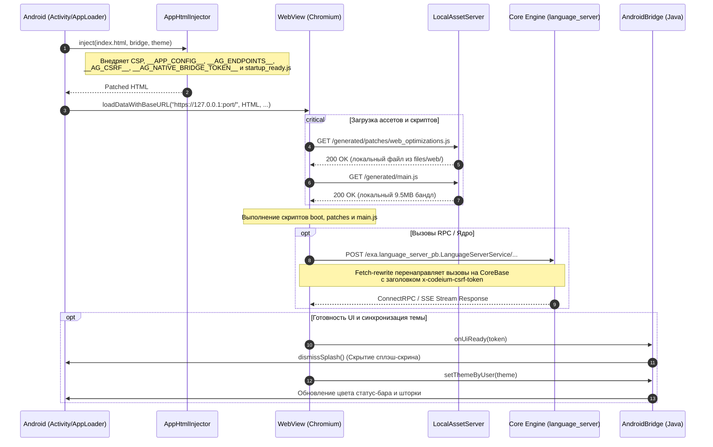

# Веб-интерфейс Antigravity: `web/`

> Одностраничное приложение (SPA на базе React), выполняемое в изолированном Android WebView и взаимодействующее с локальным Go/C++ ядром (`language_server`) через loopback HTTPS и нативный Java-мост (`AndroidBridge`).

---

## 1. Архитектурный обзор (Architecture Overview)

Веб-слой Antigravity представляет собой специализированный UI-фронтенд, упакованный в ассеты приложения и оптимизированный для работы на сенсорных экранах Android (ARM64). Вместо загрузки через классическую схему `file:///android_asset/` (блокирующую современные возможности браузера и работу ConnectRPC), интерфейс монтируется в `WebView` через `loadDataWithBaseURL` на доверенный origin loopback-сервера `https://127.0.0.1:<port>/`.

### Архитектурная диаграмма взаимодействий



---

## 2. Структура файлов и каталогов

```
web/
├── build.sh                      # Баш-оркестратор сборщика фрагментов и патчера
├── src.manifest                  # Декларативный манифест сборки web/generated/**
├── patch_main.py                 # Патчер upstream main.js (Desktop Mode + монохромное Eza)
├── index.html                    # Корневой HTML-шаблон хоста приложения
├── main.js                       # Исходный (upstream) обфусцированный бандл React UI (~9.9 МБ)
├── jetbox.css                    # Стили специфичных контролов и терминала
├── compiled_tailwind.css         # Базовый скомпилированный бандл Tailwind CSS
├── prism_bundle.js               # Бандл подсветки синтаксиса PrismJS (defer)
├── diff_worker.js                # Web Worker для фонового вычисления строковых диффов
├── audio_processor.js            # AudioWorkletProcessor для потокового аудио 16 kHz
├── antigravity-icon.png          # Иконка приложения
├── google_signin.svg             # Векторный ассет кнопки входа
├── symbols-icons/                # Локальный кэш иконок Material Symbols
├── workers/                      # Модули интеграции с PDF.js
│   ├── pdf.min.mjs               # Библиотека PDF.js core
│   ├── pdf.worker.mjs            # Воркер парсинга PDF
│   └── pdfjs_loader.mjs          # Мост между Closure compiler и ESM PDF.js
├── generated/                    # Каталог артефактов сборки (генерируется build.sh)
│   ├── main.js                   # Пропатченный рабочий бандл приложения
│   ├── bridge.core.js            # Ядро моста, полифиллы и рерайтер fetch
│   ├── boot/                     # Скрипты ранней инициализации (<head>)
│   │   ├── custom-elements-guard.js
│   │   └── theme-bootstrap.js
│   └── patches/                  # Мобильные патчи и адаптеры
│       ├── web_optimizations.js
│       ├── touch_model_menu.js
│       ├── theme_sync.js
│       └── startup_ready.js
├── src/                          # Модульные исходники фрагментов бандлов
│   ├── boot/                     # Фрагменты раннего старта
│   ├── core/                     # Фрагменты ядра моста (namespace, csrf, fetch, ...)
│   └── patches/                  # Фрагменты функциональных патчей
└── tests/
    └── selftest.sh               # Тест сборки и проверки целостности исходников
```

---

## 3. Конвейер сборки бандлов (Bundling Pipeline)

Сборка веб-слоя выполняется утилитой [`build.sh`](build.sh) на основе манифеста [`src.manifest`](src.manifest). Пайплайн спроектирован так, чтобы гарантировать **неизменность апстримного файла `main.js`**: все изменения вносятся исключительно в копию в `web/generated/main.js`.

### Синтаксис `src.manifest`
- `bundle iife <path>` — объявляет бандл с оборачиванием в изолированную IIFE `(function(){ ... })();`. Если исходные фрагменты бандла уже имеют собственное замыкание верхнего уровня, `build.sh` автоматически пропускает повторную обертку, предотвращая появление вложенных `(function(){(function(){...})()})();`.
- `bundle <path>` — объявляет бандл с прямой конкатенацией без замыкания.
- `src/<path>` — добавляет фрагмент кода в текущий открытый бандл.
- Строки `#` и `;` считаются комментариями.

### Генерируемые бандлы

| Бандл (`web/generated/...`) | Режим | Размер | Назначение |
|---|---|---|---|
| **`boot/custom-elements-guard.js`** | IIFE | ~514 B | Предотвращает краш при повторной регистрации Custom Elements в overlay-бандлах. |
| **`boot/theme-bootstrap.js`** | IIFE | ~1.3 KB | Мгновенно применяет `light`/`dark` до первого рендера, предотвращая мигание экрана. |
| **`bridge.core.js`** | IIFE | ~12 KB | Полифилл `window.process`, конфигурация, CSRF, discovery эндпоинтов и перехватчик `fetch`. |
| **`patches/web_optimizations.js`** | IIFE | ~2.2 KB | Ликвидация 300мс задержки тапа, фиксация высоты `--agy-vvh` при открытии IME, GPU-композитинг. |
| **`patches/touch_model_menu.js`** | IIFE | ~6.7 KB | Адаптация hover-меню выбора моделей Base UI под сенсорный ввод. |
| **`patches/theme_sync.js`** | IIFE | ~4.7 KB | MutationObserver за классами `<html>`/`<body>` и передача смены темы в нативный Android. |
| **`patches/startup_ready.js`** | IIFE | ~4.7 KB | Детектор первого полезного рендера DOM и перехватчик JS-ошибок для `AndroidBridge`. |
| **`main.js`** | Raw + Patch | ~9.5 MB | Рабочий бандл React UI, пропатченный скриптом `patch_main.py`. |

### Проверка валидности (Verification)
После сборки `build.sh` запускает статический синтаксический анализатор V8 (`node --check`) для каждого сгенерированного файла. Если Node.js не установлен в окружении, проверка пропускается с информационным предупреждением.

---

## 4. Патчинг основного бандла (`patch_main.py`)

Скрипт [`patch_main.py`](patch_main.py) выполняет динамическую модификацию скомпилированного и обфусцированного бандла `main.js`:

1. **Идемпотентность**: Перед патчингом проверяется наличие маркеров `"Desktop Mode"` или `"ag_desktop_mode"`. Если они присутствуют, повторное применение пропускается.
2. **Внедрение Desktop Mode Toggle**:
   - Находится сигнатура хуков компонента Appearance:
     ```python
     hook_pattern = re.compile(r'(var\s+[A-Za-z0-9_$]+=[A-Za-z0-9_$]+!==3,\s*[A-Za-z0-9_$]+=[A-Za-z0-9_$]+!==2,\s*[A-Za-z0-9_$]+=[A-Za-z0-9_$]+=>\s*[A-Za-z0-9_$]+=>\{.*?\};)')
     ```
   - Внедряются React-хуки `useState` и `useCallback`, связывающие состояние с `window.Android.isDesktopMode()` и `localStorage.getItem('ag_desktop_mode')`.
   - Находится вызов `createElement` для секции `{label:"Theme"}` и сразу за ним инжектируется элемент настройки Desktop Mode с переключателем (`Switch`).
3. **Монохроматизация логотипа Eza**:
   - Upstream-логотип Antigravity содержит жестко зашитый многоцветный SVG (`mask0_6153_71`).
   - Патчер заменяет тело компонента `var Eza=...` на монохромный плоский SVG, использующий CSS-токены `text-[#9AA0A6]` (тёмная тема) и `text-[#5F6368]` (светлая тема).

---

## 5. Взаимодействие с нативным Android (`AndroidBridge`)

Веб-приложение выполняется в WebView, где объект `Android` (а также псевдоним `window.AndroidBridge`) зарегистрирован через `addJavascriptInterface`.

### Инъекции во время загрузки (`AppHtmlInjector`)
Перед передачей разметки в движок WebView, Java-класс `AppHtmlInjector` внедряет в `<head>`:
- **Strict Content Security Policy (CSP)**: запрет небезопасных внешних фреймов и объектов, ограничение `worker-src 'self' blob:`.
- **Глобальные параметры конфигурации**:
  - `window.__APP_CONFIG__` — JSON-параметры среды (версия, платформа, пути к воркспейсу).
  - `window.__AG_ENDPOINTS__` — адрес core-сервера (`core`, `core_http`, `enginePort`).
  - `window.__AG_CSRF__` — криптографический CSRF-токен для авторизации в `language_server`.
  - `window.__AG_HOST_THEME__` / `window.__AG_RESOLVED_THEME__` — начальная тема хоста (`dark` / `light` / `system`).
  - `window.__AG_NATIVE_BRIDGE_TOKEN__` — криптографический 32-байтный одноразовый токен для авторизации привилегированных вызовов (сброс сплэша, сохранение блобов).
- **Скрипт сигнала готовности**: `<script src="./generated/patches/startup_ready.js"></script>`.

### Интерфейсы моста `window.Android`

| Метод | Сигнатура | Назначение |
|---|---|---|
| `onUiReady` | `(token: string) => void` | Вызывается скриптом `startup_ready.js` при первом реальном рендере DOM для скрытия нативного сплэш-экрана. |
| `onUiError` | `(token: string, message: string) => void` | Передает критические фатальные ошибки JS в нативный логкат и экран ошибки. |
| `setThemeByUser`| `(theme: string) => boolean` | Передает выбранную пользователем тему (`light`/`dark`) для обновления цвета системных баров Android. |
| `onVisualThemeChanged` | `(theme: string) => void` | Сигнализирует о смене активного CSS-оформления. |
| `getTheme` | `() => string` | Возвращает текущую системную тему устройства. |
| `isDesktopMode` | `() => boolean` | Проверяет, включен ли режим широкого десктопного Viewport. |
| `setDesktopMode`| `(enabled: boolean) => void` | Динамически переключает User-Agent и Viewport WebView между мобильным и десктопным режимами. |
| `openDirectoryPicker` | `() => void` | Запускает системный диалог выбора папки (SAF Document Tree) для открытия проекта. |
| `saveBlob` | `(token, base64, filename, mime) => void` | Безопасное сохранение сгенерированных веб-интерфейсом блобов в хранилище `Downloads`. |

---

## 6. Подсистемы веб-слоя

### 6.1. Подсистема тем (Theme Engine)
1. **Ранняя стадия (`theme-bootstrap.js`)**: Выполняется синхронно в `<head>`. Читает `?hostTheme=` или `__AG_HOST_THEME__`. Моментально ставит класс `dark`/`light` на `document.documentElement` и задает `style.colorScheme`. Исключает белый блик при запуске в тёмной теме.
2. **Синхронизация во время работы (`theme_sync.js`)**: 
   - `MutationObserver` слушает изменения атрибута `class` на `<html>` и `<body>`.
   - Слушатель `window.addEventListener('storage')` отслеживает смену темы во вкладках.
   - Слушатель `matchMedia('(prefers-color-scheme: dark)')` реагирует на системное расписание день/ночь.
   - Метод `notify()` обновляет нативные шторки и панели Android.

### 6.2. Мобильные оптимизации (Mobile & Touch Optimizations)
- **`web_optimizations.js`**:
  - `touch-action: manipulation` на кнопках, ссылках и инпутах отключает браузерную 300-миллисекундную задержку двойного тапа.
  - `visualViewport.addEventListener('resize')` динамически пересчитывает переменную `--agy-vvh` в пикселях, предотвращая дергание поля чата при выезде клавиатуры IME.
  - Выборочный `transform: translateZ(0)` форсирует GPU-слои только для ключевых контейнеров скролла (`chat-container`, `.scrollable`), предотвращая исчерпание видеопамяти и зависания RenderThread на чипах ARM Mali.
- **`touch_model_menu.js`**:
  - Выпадающий список выбора моделей Antigravity в библиотеке Base UI открывает меню уровней размышления (Low / Medium / High) исключительно по hover-событию мыши.
  - На сенсорном экране тап приводил к мгновенному выбору модели по умолчанию без раскрытия настроек.
  - Патч перехватывает `pointerdown`/`click` в capture-фазе, блокирует событие и симулирует синтетическую цепочку событий указателя (`pointerover`, `pointerenter`, `pointermove`), после чего посылает `KeyboardEvent('ArrowRight')` с задержками 70мс и 260мс, гарантируя открытие мобильного подменю.

### 6.3. Мост ядра и транспорт (Core Transport & Fetch Rewrite)
- **`bridge.core.js`**:
  - Создает стаб `window.process` (Linux / ARM64 / renderer) со стандартными методами `cwd()` и `nextTick()`.
  - Переопределяет `window.fetch`. Все запросы к ConnectRPC-маркерам (`exa.language_server_pb.`, `exa.host_bridge_pb.`, `/exa.`) переписываются на целевой origin ядра `https://127.0.0.1:<enginePort>`.
  - Автоматически инжектирует CSRF-заголовок `x-codeium-csrf-token` и параметр `csrf_token`.
  - Содержит логику ретрая `fetchWithStartupRetry` (до 30 попыток с шагом 120мс), что предотвращает сбои первого запроса, если фронтенд стартовал раньше, чем TLS-сокет ядра завершил биндинг.

### 6.4. Воркеры и аудиопроцессинг
- **PDF Pipeline (`workers/`)**: изолированная работа с документами в воркере `pdf.worker.mjs` без блокировки главного потока UI.
- **Diff Calculation (`diff_worker.js`)**: вычисление статистики изменений строк (алгоритм Майерса $O(ND)$ с отсечением совпадающих префиксов и суффиксов) вынесено в Web Worker.
- **Voice / Audio Processor (`audio_processor.js`)**: зарегистрирован как `AudioWorkletProcessor` с именем `audio-streaming-processor`. Осуществляет потоковый даунсемплинг аудиопотока микрофона до 16 кГц PCM (`Int16Array`) для отправки в мультимодальные модели.

---

## 7. Результаты аудита: архитектурные костыли и рекомендации

В ходе аудита веб-слоя выявлен ряд архитектурных нюансов, узких мест и костылей:

| Проблема / Костыль | Локация | Описание риска | Рекомендация по исправлению |
|---|---|---|---|
| **Отсутствие авто-сборки веб-слоя в пайплайне APK** | `modules/builder/05_stage_assets.py` | Скрипт `05_stage_assets.py` проверял и собирал `env`, но для `web/` просто копировал существующий `web/generated/`. Если разработчик правил `web/src/**` и не запустил `web/build.sh` вручную, в APK попадал устаревший бандл. | **[Исправлено]** В `05_stage_assets.py` добавлен автоматический вызов `bash web/build.sh` перед стадированием ассетов. |
| **Утечка `src.manifest` в финальный релизный APK** | `modules/builder/05_stage_assets.py` | В списке игнорируемых файлов `web_ignore` отсутствовал `src.manifest`, из-за чего исходный манифест сборщика попадал в ресурсы продакшн-APK. | **[Исправлено]** `"src.manifest"` добавлен в кортеж исключений `web_ignore`. |
| **Хрупкий Regex-патчинг `main.js`** | `web/patch_main.py` | Патчер завязан на точные сигнатуры обфусцированных переменных React (`var C=g!==3,D=g!==2...`) и содержит захардкоженные запасные имена компонентов (`item_comp="v3"`, `switch_comp="dX"`). При смене версии бандла возможен сбой инъекции или `ReferenceError`. | Реализовать верификацию синтаксиса через AST-парсер либо добавить строгие тесты проверки наличия интерфейса в CI. |
| **Избыточная двойная обертка IIFE** | `web/src.manifest`, `src/boot/theme-bootstrap.js` | Исходник `theme-bootstrap.js` уже имеет собственное замыкание `(function(){...})()`, а в манифесте объявлен как `bundle iife`. В итоге генерировался двойной вложенный IIFE. | **[Исправлено]** В `web/build.sh` добавлена проверка `is_already_iife`, предотвращающая повторное оборачивание уже закрытых фрагментов. |
| **Зависимость от `/tmp` на Android** | `web/build.sh` (строка 28) | Вызов `mktemp "${TMPDIR:-/tmp}/..."` падал на Android при отсутствии `$TMPDIR` в окружении, так как каталога `/tmp` в системе нет. | **[Исправлено]** Заменено на переносимый и безопасный путь `${TMPDIR:-${HOME:-.}/.tmp}` с автоматическим созданием каталога. |
| **Захардкоженный fallback CSRF** | `web/src/core/csrf.js` (строка 13) | Если токен не передан через `__AG_CSRF__` и отсутствует в DOM, используется константа `'agy-standalone-token'`. | Генерировать случайный UUID/Hex fallback-токен при инициализации вместо статической константы. |
| **Несогласованность схемы порта в discovery** | `web/src/core/endpoints.js` (строка 50) | При парсинге URL-параметра `?port=` выставляется `ENDPOINTS.core_http = 'http://127.0.0.1:' + port;`, хотя ядро работает исключительно по HTTPS. | Заменить схему на `https://127.0.0.1:` для единообразия с TLS-транспортом. |
| **Эмуляция событий тача через задержки** | `web/src/patches/touch_model_menu/` | Раскрытие меню моделей опирается на последовательность `setTimeout(..., 70)` и `setTimeout(..., 260)`. При сильной загрузке CPU задержки могут не успеть сработать. | Использовать MutationObserver или события смены фокуса для подтверждения открытия подменю. |

---

## 8. Проверка и тестирование (Verification)

Для проверки целостности и собираемости веб-слоя запустите тест самодиагностики:

```bash
bash web/tests/selftest.sh
```

Тест выполняет:
1. Создание изолированной временной копии директории `web/`.
2. Фиксацию контрольной суммы SHA-256 исходного `main.js`.
3. Запуск сборки `web/build.sh` и патчера `patch_main.py`.
4. Проверку, что исходный `main.js` остался неизменным.
5. Проверку генерации всех файлов и валидность путей в `index.html`.
6. Верификацию отсутствия повторных IIFE-оберток в сгенерированных бандлах.

## KR mobile attachments

Version-pinned patch_mobile_attachments.py replaces only the composer attachment
renderer and adjusts its existing picker/upload hooks. Canonical selectedMedia,
Core format/size validation and artifact uploader remain in use. Max 5 is kept
until higher Core/API compatibility is actually proven; a lower Core flag is
respected. Concurrent picker batches reserve slots. File inputs reset after
selection, including repeated selection after removal/failure.

Cards open a preview and have separate removal controls. Text is rendered as a
text node in pre, UTF-8 only, max 1 MiB, binary/NUL refused; HTML/Markdown never
executes. Raster images/audio/video use local Blob URLs revoked on removal,
preview close and unmount (including late reads). Unsupported document preview
explains the limitation and retains the existing Core openFile action where
available. No new uploads or permanent URI grants are introduced for preview.
Native dialog focus and a temporary same-route history entry support Back.

Tests: node web/tests/mobile_attachments.behavior.cjs, plus web/tests/selftest.sh.
These do not substitute for Android picker/IME/theme/device acceptance.

## KR mobile composer

The pinned composer patch preserves Lexical, send/stop/queue handling,
model/reasoning/environment selectors, permissions and voice controls.
Scoped mobile CSS increases multiline input space and controls to 48 CSS px
(Android dp at the existing viewport scale). Attachments remain above input.
The responsive + sheet receives only existing supported actions; there is no
invented camera capability. Desktop keeps its original menu. Dialog focus,
same-route history and existing native Back handling close overlays first.
The existing visualViewport/Android resize path handles IME; no independent
scroll physics, global ScrollTimeline modification or new animation is added.
Actual themes/presets/IME/TalkBack/fling acceptance remains device testing.

Composer revision after owner screenshots: empty input is compact (40 px editable minimum), +/model/send share a single footer row, and extra controls retain their original handlers in the mobile sheet. Native Back closes registered overlays before walking WebView history, with a bounded fallback for an unresponsive renderer. Android geometry now checks an upper bound as well as touch targets.


### Mobile Back and backdrop behavior

Android Back, Escape and backdrop dismissal pop the active drawer child path
before closing its root. Model effort/Usage and mobile Settings use their
original path controllers. Explicit close buttons close the root. Drawer-local
context prevents hidden Settings paths from intercepting another open drawer.
The custom overlay stack removes disposed entries even when unmounted out of
order; it never restores stale callbacks. Native chat history is used only once
the active overlay reports no handler. See mobile_back.behavior.cjs and Android
instrumentation for repeated open/pop/close coverage.


### Compact mobile model and permissions controls

Mobile Composer places the original Core permissions selector beside + as an
icon-only 48px control, preserving its preset glyph, current-mode accessible
label, conversation scope, save handlers and error reporting. When the upstream
visibility flag omits it, mobile creates the same cWb selector for non-subagent
input; desktop retains the original visibility behavior. Merely opening it does
not change permissions. No access preset or backend representation is replaced.
The model trigger remains the original button with its original open/focus and
accessible full model/effort name. Only its visible mobile label drops redundant
Gemini/Claude brand prefixes; unknown/custom names remain intact and truncate.
Menus retain full names and effort choices. Voice, Send/Stop and Back unchanged.


### Settings and neutral control surfaces

Mobile model/disabled-Send buttons and Add-menu icon discs use a grey surface
mixed from the existing palette. Enabled Send retains the active theme accent.
Settings buttons keep 48px targets with a 38.4px painted surface (20% shorter);
switch tracks retain their original dimensions. The settings page provides a
scoped context selecting Core's existing themed mobile select instead of the
Android system picker. Core values, options, callbacks and persistence remain.
Disabled controls/options, selected option semantics, Back, and custom presets
are preserved. Outside Settings and on desktop the native/custom select choice
is unchanged. No replacement settings store or new animation system is added.

### Unified mobile interface

mobile-interface.css applies one palette-derived surface, border, radius and
focus vocabulary to Core menus, settings/navigation, action buttons, user cards,
attachment cards and previews. Desktop, custom-size controls, switch tracks,
code editors, terminal and chat scroll geometry retain their original behavior.
The Add dialog becomes an inset card above the actual composer footer. A bounded
resize observer and visualViewport listeners reposition it when Android IME
changes; all observers/listeners/animation-frame callbacks are removed on close.
Existing dialog, progressive Back, Core menu choices and audio handlers remain.
Colors derive from the active theme; no preset or stored color is overwritten.

Selected setting segments and unchecked switch tracks use a distinct control
surface so they remain visible on grey groups in Light/Dark/custom palettes.

### Startup readiness proof

The startup observer no longer signals ready on the old 5.5s fallback. It
requires a visible input, action, auth/landing control or conversation content
and two animation frames before notifying the trusted native bridge. Console
hints and the existing public signal API pass through the same DOM proof.
An empty/spinner-only/hidden root stays loading; the native deadline presents
Retry. Observers/timers are released after readiness or deadline. No progress
percentage or time-based successful completion is fabricated.

Native foreground resume rearms an unfinished readiness observer after its
deadline cleanup. Rearming first clears old watchers and still requires the
same visible-DOM/two-frame proof; a paused WebView cannot permanently lose its
ready signal. Already-ready pages are untouched.

### Responsive Desktop and centered model control

All eight upstream mobileLayout consumers now use the same responsive hook as
the composer under Android's explicit mode profile. Desktop Mode adapts narrow
windows to mobile panels; wide windows retain desktop panels. Non-Android Core
feature behavior is preserved. The native document provides the query, and mode
changes regenerate that document. Desktop popups expose only a read-only
open-state hint for Android's Escape fallback. Mobile stack handlers take priority.
The model pill is centered between the permission and microphone controls;
its wrapper consumes the existing footer gap, keeping the neighboring controls
and 48px targets in place. Voice transport/send logic is unchanged.


Startup readiness requires complete document loading and
visible content/editor when Core chrome is present (a settings button alone is
insufficient). Auth/onboarding button-only pages retain their fallback. The same
content node and header geometry/palette must survive the two paint frames;
changed proof retries through the existing bounded observer instead of revealing
an intermediate header. Native additionally waits for compositor acknowledgement.
